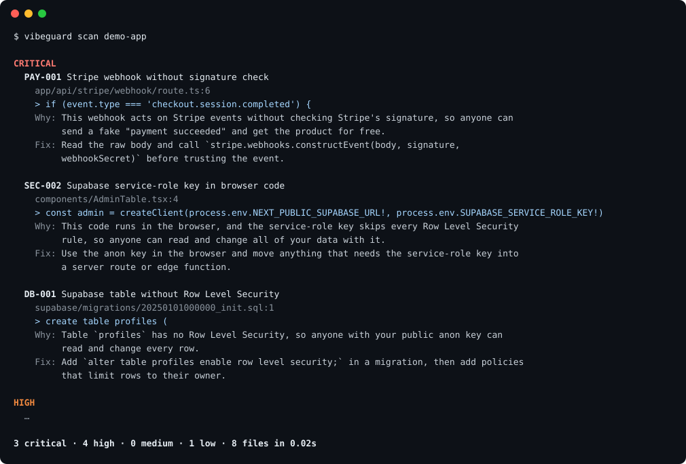
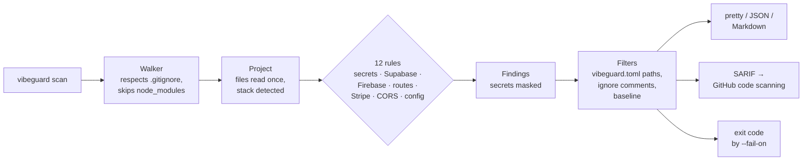
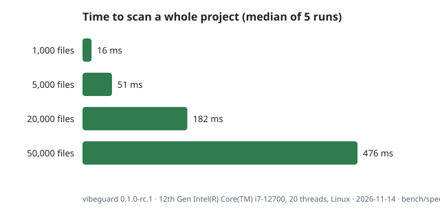

# vibeguard

[](https://github.com/uniqtechteam/vibeguard/actions/workflows/ci.yml)
[](https://crates.io/crates/vibeguard)
[](#licence)

vibeguard finds the problems that apps built quickly with AI tools tend to ship with: database tables
anyone can read, admin keys in the browser, payment webhooks that trust any caller. It reads your code
on your machine, sends nothing anywhere, and explains each finding in one sentence with the fix.



## Install

```bash
cargo install --locked vibeguard
```

Or download the binary for your system from [Releases](https://github.com/uniqtechteam/vibeguard/releases)
(Linux, macOS and Windows, with SHA-256 checksums).

## Quick start

```bash
cd my-app
vibeguard scan
```

It exits with `1` when something at or above `--fail-on` (default `high`) is found, so it can stop a
deploy. `vibeguard rules` lists every check and `vibeguard explain DB-001` explains one.

## How it works



Every file is read at most once and shared by all rules, which is why a whole project takes a few
milliseconds. Rules are plain pattern checks with small parsers for SQL migrations and Firebase rules, so
each one is easy to read and to argue with.

## What it checks

| Rule | Severity | Finds |
|---|---|---|
| SEC-001 | critical | Live Stripe, AWS, OpenAI/Anthropic and GitHub keys, private keys and Supabase service-role keys in the code; `.env` files with real secrets that git does not ignore |
| SEC-002 | critical | The Supabase service-role key in code that runs in the browser |
| SEC-003 | high | Secret-looking variables with a public prefix (`NEXT_PUBLIC_`, `VITE_`, `EXPO_PUBLIC_`, …) |
| DB-001 | critical | Supabase tables in `public` that never get Row Level Security |
| DB-002 | high | Row Level Security policies that let anyone write (`using (true)`) |
| DB-003 | medium | Public storage buckets that anyone can upload to |
| FB-001 | critical | Firestore, Storage or Realtime Database rules open to everyone, including "test mode" |
| API-001 | high | Next.js routes that change data without checking who is asking |
| PAY-001 | critical | Stripe webhooks that never verify the signature |
| PAY-002 | high | Payment amounts taken from the request instead of the server |
| WEB-001 | medium | CORS that trusts every site while sending cookies |
| CFG-001 | low | `ignoreBuildErrors`, `ignoreDuringBuilds` and production source maps left on |

Secrets are always shown masked, for example `sk_live_****WXYZ`, in every output format.

## Configuration

An optional `vibeguard.toml` at the project root; command-line flags win over it:

```toml
fail_on = "high"          # critical, high, medium, low or never
skip = ["CFG-001"]

[paths]
ignore = ["examples/**"]
```

Accept one finding with a comment on the line or the line above. The reason is required:

```sql
-- vibeguard-ignore: DB-001 public list of countries, read-only
create table countries (code text primary key, name text);
```

Already have a backlog? Record it once and only see what is new:

```bash
vibeguard scan --write-baseline .vibeguard-baseline.json
vibeguard scan --baseline .vibeguard-baseline.json
```

Other formats: `--format json`, `--format markdown` (for pull request comments) and `--format sarif`.

## GitHub Action

```yaml
permissions:
  contents: read
  security-events: write   # only needed to upload results to code scanning

jobs:
  vibeguard:
    runs-on: ubuntu-latest
    steps:
      - uses: actions/checkout@v4
      - uses: uniqtechteam/vibeguard@v0
        with:
          fail-on: high
```

The Action downloads a release binary (checksum verified), writes a summary on the job page, uploads
findings to the repository's Security tab and fails the job when something at or above `fail-on` is found.

## Speed



50,000 files take under half a second on a desktop CPU. The numbers come from `bench/speed.py`, which
generates the projects and keeps the median of five runs; `bench/results.json` has the details.

## Limits

- It checks patterns, not behaviour. A finding is a strong hint, and a clean result does not prove an
  app is safe. API-001 and PAY-002 are heuristics and are marked "check by hand".
- It knows JavaScript and TypeScript apps (Next.js, Vite, React Native/Expo), Supabase migrations,
  Firebase rules and common config files. Other stacks are not covered yet.
- It does not look for vulnerable dependencies; use `npm audit` or Dependabot for that.

## Contributing

Issues and pull requests are welcome. A new rule needs a `tests/fixtures/<RULE-ID>/bad` project that
shows the problem and a `good` one that must stay quiet. See [CONTRIBUTING.md](CONTRIBUTING.md), and
[SECURITY.md](SECURITY.md) for reporting a problem in vibeguard itself.

## Licence

Licensed under either of [Apache License 2.0](LICENSE-APACHE) or [MIT](LICENSE-MIT), at your option.

## 日本語

vibeguard は、AI ツールで素早く作られたアプリによくある問題を見つけるツールです。誰でも読める
データベースのテーブル、ブラウザに渡ってしまう管理者キー、署名を確認しない決済 Webhook などを
検出します。コードは手元で読むだけで、外部には何も送りません。見つかった問題ごとに、理由と直し方を
一文で示します。

```bash
cargo install --locked vibeguard
vibeguard scan
```

GitHub Actions では `uses: uniqtechteam/vibeguard@v0` で使えます。

---

Built by [UniqTech](https://uniqtech.dev). We also review apps built with AI tools by hand when you want a
second pair of eyes.
